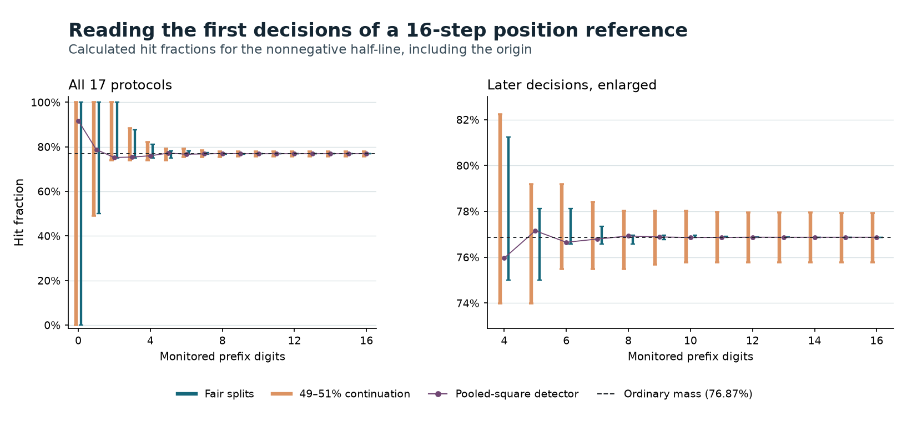

# How much of a position reference needs to be monitored?

**Kirtus Justus**, Theoretical Physicist, Port Coquitlam, British Columbia, Canada. Research supplement by Director G (OpenAI Codex), with independent construction and challenge by Codex workers.

In the 16-step signed Hadamard walk, positions at or to the right of the origin have squared mass \(p=50377/65536\). A detector that squares the two sector masses again and normalizes them gives \(G(p)=0.916971\), to six decimal places. The ordinary value is \(0.768692\). After monitoring just three balanced decisions of the compact reference, the attainable hit rate is **at most 0.882351** if each reached decision continues with probability between 0.49 and 0.51 and the resolved stopping marks are faithful. A measured change in the flag rate when monitoring is switched on would identify a disturbance or a readout dependence that needs accounting. These numbers are prospective predictions of the specified tests. [Signed flight, matching circuit and required flag comparisons](A_compact_reference_for_a_written_position.md)

## Withdraw monitoring one decision at a time

Launch the known reference for the strict threshold \(j<P\), with \(t\) digits \(b_1,\ldots,b_t\). A balanced gate splits the still-equal prefix into a parked first-difference mode and a new equality mode. The parked mark is the threshold digit \(b_k\). Final equality has mark zero. The sign convention and parity splits creating integer numerators are the ones in the preceding construction. A coherent pair of parity twins has the same mark and stopping history. Its components need never be individually resolved.

Choose \(m\) between 0 and \(t\). Through digit \(m\) let the controller read whether the reached split stopped or continued. Once stopped, preserve its mark and follow the same terminal flag-read schedule. For a surviving launch, leave the rest of the prefix preparation coherent and read its flag at the common terminal clock. The record needs to identify a genuine stop on the continued path. A new bit could monitor the still-active mode at each split, with prior stop records controlling subsequent memory writes. A terminal memory read can identify the first stop if the copied decisions are persistent and valid. The physical decision read, isolation of the flag and timing are apparatus requirements. Reading separate resolved positions and sorting them later is another instrument whose agreement would need checking.

Let \(r_m\) be the measured terminal flag rate under this protocol. Let \(e_{\rm mon}(m)\) bound \(|r_m-r_0|\) on matched launches, including any control-dependent changes to the source and flag. It can be measured directly or by telescoping consecutive differences along the nested sequence \(0,1,\ldots,m\). Comparing each individual monitor against the bare program does not bound their joint effect for an unrestricted detector. A macroscopic transcript stays in the comparison even if the walker gates are undone. The experiment compares a later read with and without earlier observations, as in tests of no signalling in time. Monitored and reset photonic walks have shown different recurrence behavior. Neither experiment establishes the present non-disturbance premise. [Kofler and Brukner](https://doi.org/10.1103/PhysRevA.87.052115) · [Nitsche et al.](https://pmc.ncbi.nlm.nih.gov/articles/PMC6025909/)

## An exact range with an arbitrary surviving detector

For reached digit \(k\), let \(l_k\le c_k\le h_k\) bound the actual conditional chance of continuing on the recorded chain. The source can have memory. Where no launch can reach the split, its contribution to the original-incident rate vanishes. Give the unknown surviving suffix a hit range \([0,1]\). If every possible remaining mark is zero, use \([0,0]\) for a faithful sharp endpoint instead. For a suffix range \([a,b]\), moving back one digit gives

\[
 b_k=0:\quad[l_k a,\ h_k b],\qquad
 b_k=1:\quad[1-h_k(1-a),\ 1-l_k(1-b)].
\]

This follows by conditioning on the two recorded alternatives. Each endpoint is attained by choosing an allowed continuation extreme and recursively using a realizing suffix law. Every intermediate rate can also be obtained by continuity on the connected box of parameters. Only one path continues. No tests on exponentially many digit histories are required. If an endpoint flag can fail, enlarge its range or bound its error weighted by the corresponding incident fraction. The same applies to the final all-zero suffix.

With ideal fairness the unresolved suffix has weight \(2^{-m}\). With imperfect fairness its actual weight is \(\prod_{k\le m} c_k\), which may exceed \(2^{-m}\). For the sixteen-tick target the digits start \(110\). At \(m=3\) exact fair splits give \([3/4,7/8]\). Allowing the illustrative one-percentage-point error on each reached split gives \([0.739900,0.882351]\); with all sixteen monitored the range is approximately \([0.757795,0.779374]\). The error allowance is a sensitivity parameter, not a measured detector precision. The unmonitored normalized-square prediction clears the three-stage upper endpoint by more than 0.03461. To use that gap for the original **flight** flag one also needs its measured transfer to the coherent reference. All transfer, monitor, endpoint, loss and sampling errors must fit within the claimed margin. The published fluorescence rate in a trapped-ion walk tests a rail sector and cannot supply those position calibrations. [Three-step rail measurement and constraints](Three_steps_and_one_fluorescence_read.md)

The plot uses the same rational interval table for every displayed point. Vertical bars show the range when every surviving nonsharp suffix can yield any hit rate. The purple points show a particular detector that reads each monitored split fairly and assigns \(G(z)=z^2/[z^2+(1-z)^2]\) to a coherent suffix of squared mass \(z\). Writing \(A_m=\lfloor 2^m p\rfloor\) and \(z_m=2^m p-A_m\), its rate is \((A_m+G(z_m))/2^m\). It passes every local fair-split test and every sharp endpoint check. At \(m=0\) it reads 0.916971; at \(m=3\) it reads about 0.753749. Thus a direct monitored-versus-bare comparison supplies information inaccessible to the splitter calibration alone. The right panel enlarges depths 4–16; the full panel retains all values. [Exact table, including plot input](results/stopped_position.json) · [Matplotlib rendering](plot_stopped_position.py)

The Rust PCP host rendered the three series in the same table as SVG, including the eight nonzero ranges whose two endpoints project to a single pixel. An open circle preserves their distinction from exact point predictions. Both the terminal command and the machine interface returned identical image bytes. To replay, pass the JSON object's `plot` member to a graph-capable host on standard input with `pcpos plot`. Matplotlib reads that member directly for the publication figure. [Rust rendering](results/stopped_position.svg) · [Source table](results/stopped_position.json)

## Signed residuals on original incidents

The deepest reached split may have too few arrivals to estimate a conditional probability. Work with counts on the original denominator \(N>0\). At stage \(k\) partition the \(C_{k-1}\) entering launches into confirmed stops \(S_k\), confirmed continuations \(C_k\) and first unread exits \(L_k\), with \(C_0=N\). Define \(J=\sum_{k=1}^{m} b_k S_k\), and let \(z_k=0.b_{k+1}\ldots b_t\), so \(z_0=p,\ z_t=0,\ 2z_{k-1}=b_k+z_k\). Then

\[
 J+C_m z_m+\sum_{k=1}^{m}L_k z_{k-1}-Np
   =\sum_{k=1}^{m}\left(C_k-\frac{C_{k-1}-L_k}{2}\right)(z_k-b_k).
\]

At each stage substitute \(C_{k-1}=S_k+C_k+L_k\) and the suffix recursion. The terms \(C_k z_k\) telescope. The identity gives a signed diagnostic even when all remaining launches are lost. The assigned terms \(L_k z_{k-1}\) are algebraic reference quantities. The record contains no such observed hits. With faithful recorded marks, the minimum complete hit count is \(J\). The maximum adds \(C_m\) if the uninspected suffix can hit and adds each \(L_k\) whose still-possible outcomes include a hit. All extrema are attainable under arbitrary missing binary completions. A missed flag whose written mark is known can be further constrained if that mark-to-flag transfer is calibrated. Physically absent launches and changed source populations need their own exposure model. These are finite-record bounds. Population intervals require a sampling model or a design-based confidence procedure.

For a **synthetic** 128-incident table with rows \((S_k,C_k,L_k)=(65,61,2),(29,31,1),(14,16,1)\), 94 hits are known by stopping, 16 launches are still live, and four left unread. The interval is 94 through 114 hits. The normalized signed residual in the identity is \(1225/1048576\). This small residual does not resolve the twenty unknown outcomes. At an all-zero remaining suffix a lost split label may leave the logical mark perfectly known. Conversely reusing one fair hidden digit for all digits yields a threshold rate of \(1/2\) for this target: marginally fair digits do not imply fairness conditional on reaching the next stage. [Exact replay and 1,040 incident tables](check_stopped_position.py) · [Lean identity before telescoping](lean/StoppedPosition.lean)

The shallower tests replace a single comparison to a mixture of all stopping histories with a measured disturbance and a few conditional splitter checks. A complementary experiment uses coherent selector flips and reads the midpoint at each split without taking a persistent path transcript. Neither protocol has been performed on the designated walk. Selection of an absolute phase embedding and the physical origin of these controls remain open. [Coherent selector experiment](A_selector_for_each_prefix_split.md) · [Ontology gate map](ontology_gate_map.json)
