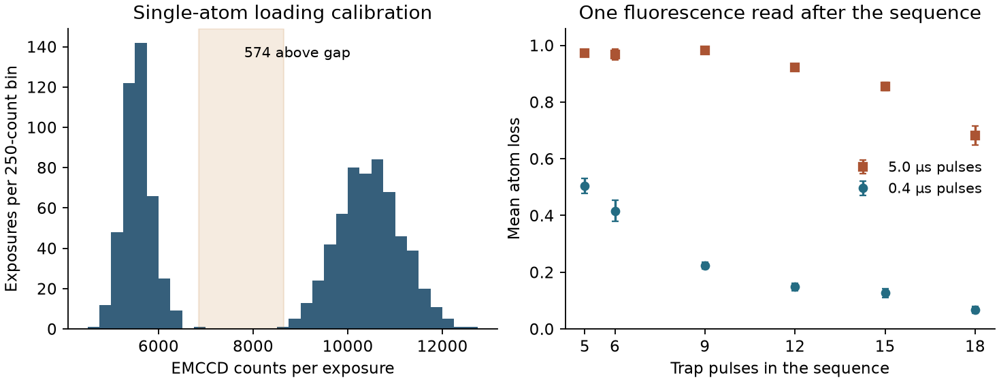

# What fluorescence records in a single-atom recapture experiment

**Kirtus Justus**, Theoretical Physicist, Port Coquitlam, British Columbia, Canada. Research supplement by Director G (OpenAI Codex).

Can a binary reading of a moving atom test the ordinary probability assigned to a set of positions? Zhang and colleagues released a single rubidium atom and pulsed an optical tweezer during its free flight. Fluorescence at the end indicated whether the atom remained trapped. Their deposit contains 1,000 individual calibration exposures and aggregate loss rates from two pulse protocols. The calibration permits an exact recount. The comparison between pulse protocols measures how much the physical preparation matters. [Article, 12 June 2026](https://doi.org/10.1038/s41467-026-74332-1) · [Authors’ Zenodo v1 deposit, 22 April 2026](https://doi.org/10.5281/zenodo.19690318)

## Which incidents enter each result

The first 20 ms fluorescence image identified traps containing a single atom. A second image 40 ms after the first determined survival. The experiment used three batches of 500 attempted preparations per point, with about 300 loaded atoms per batch. Those are design and approximate yield figures. The deposit supplies neither batch-specific exact loaded counts nor paired initial/final readouts for the six pulse settings. Nor does it give an intervening sequence of fluorescence bits. The trap pulses couple to a bound-state **subspace** of a finite-depth Gaussian potential. Motion, momentum and trap depth all matter to recapture. An atom at a given position is not thereby known to occupy a bound mode. [Apparatus, timing and selection](https://pmc.ncbi.nlm.nih.gov/articles/PMC13408358/)

We read all 1,000 integer EMCCD totals from the deposited calibration file. Their range is 4,727 to 12,528, with a unique largest adjacent gap from 6,851 to 8,645. For the convention “loaded if counts \(\ge h\)”, **every integer threshold from 6,852 to 8,645 inclusive gives 574 loaded and 426 empty**. This reproduces the authors’ stated loading range of 0.5–0.6 for a threshold in the gap. The deposit’s plotting program specifies no numerical threshold. With no independent occupancy labels, stability to the choice of threshold does not measure the false-positive or false-negative rate. In particular, 574 belongs to this calibration sample and supplies no denominator for any pulse setting. [Exposure sample and figure sources](https://zenodo.org/records/19690318)

The left histogram uses new 250-count bins and preserves both extremes. The right panel shows the deposited means and across-batch standard deviations. Only the left panel is computed from per-exposure records.

## How much can a shared loss rate explain?

The total free-flight time was 45 µs at every setting, excluding time in the trap. Pulses lasted 0.4 or 5.0 µs. The table retains every short/long comparison in deposited Fig. 1(c). The simulated values are the short-pulse Monte Carlo points from its separate array. Parentheses give the experimental standard deviation in the last displayed digits.

| Pulses | Measured short-pulse loss | Measured long-pulse loss | Short-pulse simulation \(m\) | Feasible mean square response if \(m=\mathbb E P\) |
|---:|---:|---:|---:|---:|
| 5 | 0.5036 (264) | 0.9722 (48) | 0.4812 | 0.37375–0.58086 |
| 6 | 0.4162 (374) | 0.9684 (187) | 0.4175 | 0.29686–0.50397 |
| 9 | 0.2238 (118) | 0.9824 (27) | 0.2637 | 0.11368–0.31831 |
| 12 | 0.1483 (128) | 0.9224 (38) | 0.1963 | 0.05630–0.23696 |
| 15 | 0.1267 (154) | 0.8549 (146) | 0.1125 | 0.01581–0.13580 |
| 18 | 0.0679 (122) | 0.6821 (343) | 0.0475 | 0.00248–0.05734 |

If a model assigns one loss rate to the two pulse durations at fixed pulse count, the smallest possible maximum absolute discrepancy from their two central values is half their difference. The midpoint attains it. At twelve pulses that bound is **0.38705**. A common fluorescence response can still give two very different rates because in-trap evolution changes the incident state. The original authors study that duration dependence. A binary terminal read alone does not certify that a prior control preserved its recorded answer. [Experimental pulse comparison](https://pmc.ncbi.nlm.nih.gov/articles/PMC13408358/) · [Held-flag comparison in the walk](A_compact_reference_for_a_written_position.md)

## An exact test for a proposed transfer of the simulated means

Suppose, as an additional hypothesis, that each short-pulse setting is described by a latent loss-sector mass \(P\in[0,1]\) of known mean \(m\). Compare an ordinary response to the normalized-square response \(G(p)=p^2/[p^2+(1-p)^2]\) on each incident. Arbitrary source variation makes \(G(m)\) an insufficient prediction. Put \(a=1/\sqrt2\) and \(k=(1+\sqrt2)/2\). The sharp possible interval for \(\mathbb E G(P)\) has endpoints \(1-U(1-m)\) and \(U(m)\), where

\[
 U(m)=\begin{cases}km,&0\le m\le a,\\G(m),&a\le m\le1.\end{cases}
\]

Indeed \(G(p)/p=p/[p^2+(1-p)^2]\) for \(p>0\) attains its maximum \(k\) at \(a\). The line \(kp\) touches \(G\) there. Differentiation gives \(G''(p)=2(2p-1)(2p^2-2p-1)/[p^2+(1-p)^2]^3\), which is nonpositive on \([a,1]\). Thus \(U\) is a concave majorant. Mixing input 0 and \(a\) when \(m\le a\), or choosing \(P=m\) otherwise, attains it. Complementation gives the lower bound. Mixtures of these equal-mean extremizers give every intermediate value.

If the six simulation entries are stipulated as the **exact** means, the first five measured short-pulse central values can each be attained under the same square law with an appropriate source distribution at that setting. At eighteen pulses the measured central value exceeds the upper endpoint by **0.01056243**. Raising \(m\) from 0.0475 to at least \(0.0679/k\approx0.05625020\) would close the gap without an output correction. Holding the mean fixed requires an absolute output discrepancy of at least 0.01056243, rounded. The observed excess is smaller than the reported standard deviation 0.0122. Neither that standard deviation nor the Monte Carlo array gives a simultaneous confidence limit for these six comparisons. The interval controls an arbitrary distribution at each setting; a shared dynamical law across settings would impose additional constraints.

The deposited pulse-count simulation itself samples a thermal launch state and makes stochastic survival decisions under squared overlaps through **each** pulse and the final read. In its source a successful projection returns the initial sampled state, and the loop specifies 800 trajectories per setting. The article’s methods text says 500 simulated trajectories. The archived plotted points are the input to our calculation. We do not reconstruct a simulation run, infer its exact integer counts, or treat the simulation outputs as independently measured pre-detection masses. A law that changes individual survival decisions can also change which states reach later pulses. A terminal nonlinear rescaling of the tabulated loss cannot represent that change. [Authors’ pulse-count simulator](https://zenodo.org/records/19690318/files/1D_Experiment_measure_PvsN_MC_ini_state.py) · [Methods and pulse sequence](https://pmc.ncbi.nlm.nih.gov/articles/PMC13408358/)

This experiment contributes an independently reproducible loading check and a large controlled change in terminal survival. Testing a spatial Hadamard walk’s ordinary embedding still requires the actual site-membership write, eligible-incident denominator and calibration of the complete terminal apparatus under the chosen controls. A different cesium experiment measured the effect of shifting aside one arm. A time-multiplexed optical recurrence experiment used a continual sink and coherent light. Neither supplies the missing matched flag shots here. [Cesium first-step measurements](Cesium_negative_read.md) · [Optical recurrence experiment](https://pmc.ncbi.nlm.nih.gov/articles/PMC6025909/) · [Direct electronic-rail read and its scope](Three_steps_and_one_fluorescence_read.md)

**Replay.** Run the following from the repository, using a new output path. The checker downloads the 11,714-byte versioned archive, verifies its SHA-256, reads numeric literals from the deposited plot source without executing it, and counts every calibration exposure.

    python -B Director_G/check_atom_recapture.py NEW_RESULT.json

The optional --archive FILE argument supports offline replay. The --plot NEW_FIGURE.png argument regenerates the figure with Matplotlib. The archive and member hashes, bin counts, all 14 simulation points, six experimental pairs and residuals are in the [replay output](results/atom_recapture.json). The plot and calculations adapt Zhang, Chen and Ding’s deposited data under [CC BY 4.0](https://creativecommons.org/licenses/by/4.0/).
