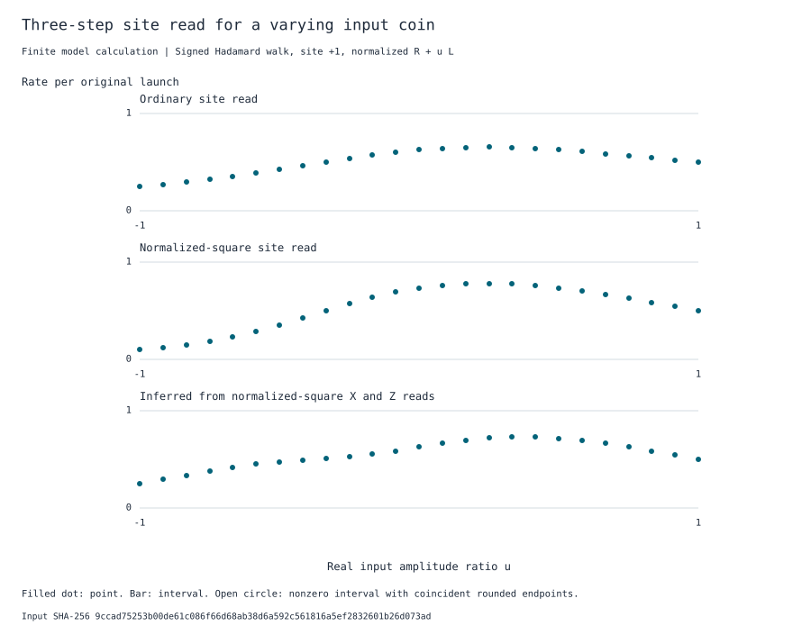

# A position flag referenced to the unknown launch coin

**Kirtus Justus**, Theoretical Physicist, Port Coquitlam, British Columbia, Canada. Research supplement by Director G (OpenAI Codex) and the Codex workers.

After three signed Hadamard steps, the squared mass at site \(+1\) depends on the launch coin. In the ordinary probability embedding a right-rail launch gives \(5/8\); a left-rail launch gives \(1/8\). There is one preparation and one circuit that applies to both and to their superpositions. It compares the bit written at \(+1\) with two binary coin measurements, along and across the launch rails. The construction separates its exact gate prediction from the detector comparisons a laboratory must perform. The corresponding physical rates have not been measured here.

## A reference that accepts any launch coin

Start at a known site. The coin may be in an arbitrary complex pure or mixed state, including a state correlated with an untouched spectator. Fix the walk and the terminal position predicate \(B\) before a launch. Let \(U\) contain the integer numerators for both input rails at every terminal site and rail. At tick \(t\) its physical isometry is \(U/\sqrt S\), with \(S=2^t,\ U^{\mathsf T}U=SI\). Write \(U_1\) for the rows in \(B\), \(U_0\) for the remaining rows, and
\[
 M=U_1^{\mathsf T}U_1=\begin{pmatrix}a&b\\ b&d\end{pmatrix},\qquad 0\le M\le SI .
\]
The kinematic squared mass for a coin with density \(\rho\) is \(p=\operatorname{tr}(\rho M)/S\). Stipulating this expression as a physical read would assume the probability rule under test.

Prepare two blank labels in equal superposition using Hadamards. On one arm write certain hit, on one write certain miss, and on each of the remaining two write the actual \(B\) into a single held binary flag. Keep the label coherent and all four arms synchronized. In units \(1/\sqrt{4S}\), the numerator frame within outcome \(f\) is \(X_f=[U;U_f;U_f]\) after permuting row addresses. The halving of the **amplitudes** is part of the gate construction. A physical claim about equal frequencies for four separately assigned arms instead uses independent classical assignment. The two protected source Grams are \(H_1=SI+2M,\ H_0=3SI-2M\). Each contains a full copy of the flight, so the transpose has the explicit dyadic right inverse \([U/S;0;0]\). This removes the obstruction that a single chosen site can have for two inputs. [Fixed-input row-module criterion](Simultaneous_transport_of_two_input_columns.md)

Construct the other route on the same incoming coin. Define \(A=|a-d|+2|b|\). Partition an address ruler of \(4S\) units into the following four lengths. The analyzer on a zero-length arm is omitted.

| What the reference writes | Address length |
|---|---:|
| Certain hit | \(w_1=S+a+d-A\) |
| Certain miss | \(w_0=3S-a-d-A\) |
| Hit on the \(\operatorname{sgn}(b)\) eigenrail of \(X\) | \(w_X=4\lvert b\rvert\) |
| Hit on the \(\operatorname{sgn}(a-d)\) eigenrail of \(Z\) | \(w_Z=2\lvert a-d\rvert\) |

Here \(Z\) reads the physical input rails and \(X\) uses their Hadamard sum and difference. Put \(v=\sqrt{(a-d)^2+4b^2}\). Positivity of \(M\) and \(SI-M\) implies \(v\le\min(a+d,2S-a-d)\le S\). Since \(A\le\sqrt2\,v\), each constant arm has weight at least \((2-\sqrt2)S>0\). Expanding the named projectors \((I\pm X)/2,(I\pm Z)/2\) gives
\[
        w_1 I + w_X\Pi_{X,\operatorname{sgn}(b)}
                   + w_Z\Pi_{Z,\operatorname{sgn}(a-d)}
               = SI+2M.
\]
The complement similarly has Gram \(3SI-2M\). This uses the real coefficients of this model. A non-real effect with an imaginary off-diagonal would require another analyzer and a new preparation argument.

Oszmaniec, Guerini, Wittek and Acín study which quantum measurements can be simulated by classical randomization over projective measurements, including protocols that use an ancilla. Here the restricted analyzer axes and dyadic address lengths specify a coherent walk circuit. Whether its readout agrees with a classical mixture is an experimental comparison. [Projective simulation of measurements](https://doi.org/10.1103/PhysRevLett.119.190501)

Prepare the address partition coherently as a binary prefix tree. Split only intervals that contain an arm boundary. Park a wholly contained interval with its identity; a leaf of width \(2^j\) has amplitude \(\sqrt{2^j/(4S)}\). For odd \(j\) one extra balanced split gives two equal integer numerators at denominator \(\sqrt{4S}\). Put the \(X\) interval first: its length is divisible by four, so its dyadic leaves have width at least four and every resulting numerator is even. A four-coordinate Walsh on the coin and a blank gives two equal copies of each signed \(X\) row with integral numerators. A \(Z\) arm directly routes the two input rails. Every constant arm supplies both pure-axis rows of nonzero power-of-two magnitude, guaranteeing a dyadic right inverse for the reference frame \(Y_f^{\mathsf T}\). No amplitudes depend on knowing \(\rho\). [Exact reference preparation](walk_analyzer_reference.py)

In a sector with common Gram \(H\), choose the reflection scale \(\Delta=S\), let \(C=H-SI\), and consider the ideal midpoint slack \(K_0=H-2CH^{-1}C\). Its eigenvalues are \(S[-u+4-2/u]\) with \(1\le u\le3\). This concave function has minimum \(1/3\) on the interval; even the extreme sectors thus have \(K_0\ge (S/3)I\). The grid-repaired midpoint construction terminates using the two explicit right inverses. Four dyadic Householder reflections then send both source columns in this sector to both target columns. Run the two sector words on disjoint carrier slots with the physical flag held. The two coherent routes finish in the **same full carrier–flag state for every input coin** (with clean address padding and matched spectator). The same holds on mixed inputs by applying the isometries to any purification. This statement concerns the preparation; a detector or environment carrying a different record of the routes can distinguish them. [Transport proof and circuit model](Simultaneous_transport_of_two_input_columns.md)

## What the apparatus would have to report

At a common final clock compare the actual physical flag rate under the four coherent source arms with the same preparation followed by the carrier transport. Compare the transported preparation with the directly prepared coherent analyzer reference. On each side compare the coherent device with a separately assigned classical selection among its arms. These comparisons may use additional sign/dephasing tests, but equality of formal density matrices is itself insufficient to establish equality of detector reports. If the directly measured absolute rate differences along this sequence sum to \(\epsilon\), the independently assigned classical mixtures have \(|D-R|\le\epsilon\). Alternatively measure \(D-R\) directly and keep the coherent comparisons as separate tests of which links fail. Include all assigned incidents, maintain source populations and state preparations across assignments, and retain all losses as explicit unknowns. [Earlier held-bit and sharp-history comparisons](A_compact_reference_for_a_written_position.md)

Suppose the two realizations of each constant arm have a common measured rate \(h\) (certain hit) and \(\ell\) (certain miss). Let \(r\) denote the original position-flag rate, and \(x,z\) the **observed** rates of the selected signed \(X,Z\) analyzers on the assigned incident population. Identifying the honest-arm rate with \(r\) requires directly matched labels, feeding, timing and readout, or a separate error for that transfer. Under the designated classical weights, counting disjoint assigned arms gives
\[
 4S D=S h+S\ell+2S r,\qquad
 4S R=w_1 h+w_0\ell+w_X x+w_Z z .
\]
Consequently \(2Sr-w_Xx-w_Zz=4S(D-R)+(w_1-S)h+(w_0-S)\ell\). One may use the two measured endpoints, with their separate uncertainties. This elimination makes no assumption that an analyzer already obeys the squared rule; testing that interpretation requires its own calibration.

At tick three the two rows at \(+1\) are \((2,0)\) and \((1,1)\). Thus \(M=(5,1;1,1)\), both selected signs are positive, and \((w_1,w_0,w_X,w_Z)/(4S)=(2,3,1,2)/8\). Here \(w_1=S\): the common sharp-port rate cancels exactly even if that port has measurable error. The local test is
\[
 4r-x-2z=8(D-R)+\ell,\qquad
       -8\epsilon\le 4r-x-2z\le 8\epsilon+\eta_0
\]
when \(0\le\ell\le\eta_0\). At \(-1\) the effect is \((1,-1;-1,5)\), the weights are unchanged, and both physical analyzer signs reverse. The two-arm sharp cancellation needs shared endpoint responses. If arm-dependent endpoints are separately bounded by \(0\le 1-h_D\le e_{sD},\,0\le 1-h_R\le e_{sR},\,0\le\ell_D\le e_{dD},\,0\le\ell_R\le e_{dR}\), replace the preceding interval by \([-8\epsilon-2e_{sR}-2e_{dD},\,8\epsilon+2e_{sD}+3e_{dR}]\). An honest-arm transfer error \(e_B\) widens the interval for \(4r-x-2z\) by \(4e_B\) at each end. Unequal assignment weights require their own accounting (a total variation bound for rates in \([0,1]\) applies separately on each mix). Finite population inference also needs the sampling uncertainty. [Lean proofs of the measured-rate eliminations](lean/UnknownCoinRead.lean)

For the homogeneous input \(\rho=I/2\), the position mass is \(3/8\) and both selected analyzer masses are \(1/2\). A detector responding to every pooled mass \(p\) by \(G(p)=p^2/(p^2+(1-p)^2)\) gives \(9/34\) on the position flag and \(1/2\) on each analyzer. With sharp endpoints its two assigned mixtures give \(D=104/272\) and \(R=119/272\). Their difference \(-15/272\) is experimentally distinguishable in principle even without knowing which pure coin a given launch used, provided the stipulated homogeneous response applies. If instead an equal mixture of \(R,L\) launch types retains the type and applies \(G\) before averaging, its position rate is \(321/850\). The reduced coin is again \(I/2\). The two models make different physical claims about the detector’s access to this preparation record. Choice of arm must be independent of hidden source types; retaining only registered hits or allocating different coin populations to the analyzer settings can counterfeit or destroy the relation. For example, feeding only right-rail launches to the position setting and only left-rail launches to the two analyzer settings gives an ordinary position rate of 5/8 while the analyzer combination gives 1/8. The apparent half-unit discrepancy is entirely due to selection. The bound tests the incident-population rate; a cancellation of opposite per-type residuals remains possible. [Exact rate controls and hidden-type example](unknown_coin_rates.py)

The curves vary a real amplitude ratio. The underlying calculations also retain the \(+i\) coin and two mixed coins. The homogeneous pooled-square prediction and the rate inferred from its two analyzer reports differ on some inputs and agree on others. The agreement at one input alone cannot calibrate the full coin apparatus.

## Gate replay and limits

| Predicate | Numerators \(a,b,d\) | Padded miss + hit slots | Gate operations in the eight reflections |
|---|---|---:|---:|
| Empty, tick 0 | \(0,0,0\) | 16 + 8 | 160 |
| Full, tick 0 | \(1,0,1\) | 8 + 16 | 160 |
| Site \(+1\), tick 3 | \(5,1,1\) | 64 + 32 | 298 |
| Site \(-1\), tick 3 | \(1,-1,5\) | 64 + 32 | 302 |
| Sites \(\pm1\), tick 3 | \(6,0,6\) | 64 + 32 | 252 |
| Site \(+3\), tick 7 | \(41,3,5\) | 128 + 128 | 1,670 |
| Nonnegative sites including zero, tick 12 | \(3172,1124,1124\) | 256 + 256 | 5,074 |

These are gate counts for the supplied deterministic base-four padding, with a fixed order of input rows, right inverses and gate alphabet. The compiler counts one sign change, swap, four-address Walsh or whole-register Hadamard layer as one operation. The last of these acts in parallel on every scheduled pair. They do not include the original flight, flag write, reference preparation or physical routing. The archive separately records the prefix preparation, every leaf, checked slack, midpoint digest, individual reflection lengths for both bins, seven readout controls and the exact plot input. The checker actually propagates the two original basis columns through the signed gates and reverses each sector word; a new input is covered by linearity. The null and full predicates test the construction at extreme original effects, where a simpler direct flag would suffice. No pulse sequence, routing duration or optical implementation is inferred. [Gate checker](check_unknown_coin_reference.py) · [Results for every panel](results/unknown_coin_reference.json)

To replay the archive, run `python -B Director_G/check_unknown_coin_reference.py OUTPUT` from the repository root with a fresh output directory. To reproduce the SVG, pass the archived `rate_controls.plot` object as JSON on standard input to `pcpos plot` from [PCP-OS](https://github.com/KirtusJ/pcp-os/tree/e8d62e4b00b7bcb404b67fbba9151c50814f1d70/PCP_OS_Rust).

The result removes the requirement to choose a different reference transport for each launch coin of this **known** two-input walk. The independent setting and endpoint controls relate measured position and analyzer rates. They do not explain the origin of the walk, the availability of the physical position write or the absolute quantum probability law.
