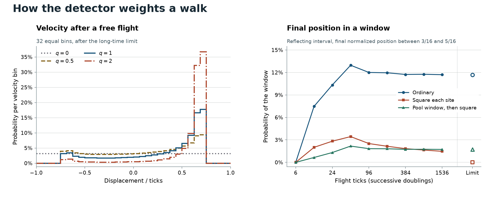

# Which probability powers preserve the classical velocity law?

**Kirtus Justus**, Theoretical Physicist, Port Coquitlam, British Columbia, Canada. Research supplement by Director G (OpenAI Codex).

A particle launched at one well on the right rail of the signed Hadamard walk has a continuous spread of classical velocities under ordinary position weighting. Can a detector that changes its probability exponent between launches reproduce this spread? **If the detector pools positions into the specified equal velocity bins before applying its power, agreement with the full limiting velocity distribution forces the ordinary exponent on almost every launch.** The test uses one sharp source, unmodified forward propagation and a terminal position read. It requires reproducibility across flight lengths and bin widths. It works within a specified class of probability laws and does not identify an arbitrary measurement theory. [Reflected trajectories and the classical velocity density](Reflected_position_histories.md) · [Finite single-setting tests with an additional readout flight](Four_ticks_after_a_recorded_walk_output.md)

## Which read is varied

Launch on rail \(R\) at the origin of the line, or at an interior well of a reflecting interval far enough from each wall for \(t\) unreflected ticks. Write \(p_t(x)\) for the sum of the two squared rail amplitudes at displacement \(x\). It is a number calculated from the signed walk. Choose \(t=2^m-1\) and divide the velocity coordinate \(x/t\in[-1,1]\) into \(N=2^k\) equal half-open bins, with \(+1\) in the last bin. For bin \(I\) set \(b_I(t)=\sum_{x/t\in I}p_t(x)\). On one launch a finite exponent \(q\ge0\) gives bin \(I\) the observed probability \(b_I(t)^q/\sum_J b_J(t)^q\), with empty bins dark also at \(q=0\). This read allows no earlier observation of the actual site or rail. The distribution \(\mu\) of \(q\) can be arbitrary but must be fixed across this family of settings. Read every launched trial, or independently model losses, misclassified bins and uncertainty.

Take the long-flight limit **first at fixed \(N\)**, then refine the mesh. The measured limiting law is the weak limit of the bin-midpoint distributions. Written in this rail convention, the ordinary kinematic limit has density
\[
 f(v)=\frac{1+v}{\pi(1-v^2)\sqrt{1-2v^2}},\qquad |v|<v_*=\frac1{\sqrt2},
\]
and zero elsewhere. The weak limit and the estimates for individual sites in the ballistic interior and at its edges follow from the Fourier representation of the walk. The edges at \(\pm v_*\) are the extrema of group velocity. The fastest individual direction words can reach \(x/t=\pm1\). [Konno, line-walk limit](https://arxiv.org/abs/quant-ph/0206103) · [Sunada and Tate, Theorems 1.1 and 1.3](https://arxiv.org/pdf/1108.1878)

## What each exponent displays

For \(q>0\), convergence of each \(b_I(t)\) to \(b_I=\int_I f\) is enough at fixed \(N\), since the boundaries have zero limiting mass. Write \(\Delta=2/N\) and \(g_N(v)=b_I/\Delta\) on bin \(I\). Spreading each midpoint's probability uniformly on its bin gives density \(g_N^q/\int g_N^q\). This spreading changes a continuous test function's expectation by at most its modulus of continuity over one bin.

* For **\(0<q<2\)**, the limit density is \(f^q/Z_q\), \(Z_q=\int_{-1}^1 f^q\). Each edge singularity is proportional to the inverse square root of distance, which is integrable to power \(q<2\). The bin averages converge to \(f\) in \(L^q\) for \(q\ge1\) in this range, by approximation with continuous functions and the contraction of bin averaging. Their powers then converge in \(L^1\) by Hölder's inequality (directly for \(q=1\)). For \(q<1\), \(L^1\) convergence of the averages and \(|a^q-b^q|\le|a-b|^q\) give \(L^1\) convergence of their powers on the bounded interval.
* For **\(q\ge2\)**, the whole limiting law consists of two point masses at \(\pm v_*\). Indeed \(g_N\to f\) at almost every point and Fatou's lemma gives \(\int g_N^q\to\infty\), including at \(q=2\). Away from fixed neighborhoods of the two edges the averages remain bounded. To find the split, pair each positive-velocity bin with its reflection. On the positive support \(f(v)/f(-v)=(1+v)/(1-v)\). The pooled mass ratio of a mirror pair is between the minimum and maximum of that function over the occupied part, also for the bin straddling the front. Shrinking the front neighborhoods squeezes the limiting positive-to-negative odds to \((3+2\sqrt2)^q\). Thus at \(q=2\) the right-front fraction tends to about 97.14%, although the ordinary velocity distribution gives neither front an atom.
* For **\(q=0\)**, the reported bin is uniform over the entire velocity interval in the limit. With \(j\) right proposals the signed rail numerators add modulo two to \(\binom tj\bmod2\), since removing path signs leaves the same parity. Over \(\mathbb F_2\), \((1+X)^{2^m}=1+X^{2^m}\). Division by \(1+X\) gives \((1+X)^{2^m-1}=\sum_{j=0}^{2^m-1}X^j\). Thus each reachable site has at least one nonzero rail and for fixed \(N\) all bins eventually have positive kinematic mass. Small but nonzero masses outside the velocity fronts matter here. Dropping these tails before scoring changes this answer. The [Lean parity calculation](lean/VelocityMeshParity.lean) supplies a separate arithmetic check.

Bounded continuous tests permit averaging these limiting laws over \(\mu\) by dominated convergence in the stated order. If the observed law equals \(f(v)\,dv\), its zero mass outside \([-v_*,v_*]\) forces \(\mu(\{0\})=0\). Its zero mass at the two fronts forces \(\mu([2,\infty))=0\), since all other components are positive measures. The remaining identity is
\[
 1=\int_{(0,2)}\frac{e^{(q-1)\log f(v)}}{Z_q}\,d\mu(q)
\]
at almost every interior velocity. Near zero \(f\) is positive and has nonzero derivative. There \(\log f(v)\) covers an interval, and its inverse is smooth on a sufficiently small neighborhood. The right side is continuous in \(\log f\), since \(q\in(0,2)\) and \(Z_q\) is bounded below uniformly by integrating on a fixed compact interval where \(f\) is bounded away from zero. The identity thus holds throughout this interval. Every integrand is strictly convex in \(\log f\) if \(q\ne1\). A positive mixture with any such weight is strictly convex and cannot equal a constant there. Hence \(\mu=\delta_1\). Conversely that law produces \(f\). A fixed fair unsigned-path component could also be included: its terminal velocity converges to zero in probability by the binomial variance, and its extra atom at zero would force its weight to vanish. Sequential position measurements on a single walker require a separate state-change test. [Testing the detector with actual prior memory](Checking_a_cut_with_the_memory_of_the_actual_flight.md)

If \(q\) is allowed to depend on the setting, even exponents different from one on every finite flight can give the ordinary limiting distribution. Take \(q_N=1+1/N\). On any \(N\)-cell table the total variation discrepancy is bounded by \(\log(N)|\log q_N|\), by integrating the derivative of the powered law. The bound tends to zero regardless of the flight length. A detector that first samples an exact site by another rule and only then reports the velocity bin also falls outside the theorem. [Finite power transfer and entropy bound](From_five_forward_ticks_to_a_coherent_position_read.md)

## A different prediction when the detector resolves individual wells

The sensitivity of high probability moments to ballistic fronts also occurs in continuous-time tight-binding propagation. De Toro Arias and Luck calculate this effect for moments of the local probability density. Here the observable is the normalized arrival distribution of the discrete-time walk, and the detector can group its rails differently at each well. [De Toro Arias and Luck, dynamical participation numbers](https://arxiv.org/abs/cond-mat/9808021)

Suppose each exact well or its two rails is powered **before** grouping the locations in a reported bin. Even if the partition into one or two cells is chosen separately at every site, any powered law with \(q\ge2\) concentrates near the two ballistic fronts. This concentration is uniform over the powers and partitions. It also permits arbitrary choices among tied maxima. This statement alone leaves the weights on the two fronts undetermined for a site-resolved detector.

To see this write \(h_x=p_t(x)\). First, \(t\sum_x h_x^2\to\infty\). On each interval \(I\) of a fixed velocity partition, Cauchy–Schwarz gives \(t\sum_{x/t\in I}h_x^2\ge(\sum_{x/t\in I}h_x)^2/(|I|+2/t)\), since there are at most \(t|I|+2\) sites. Sum and take the lower limit, then refine the partition. The resulting lower bounds \(\sum_I b_I^2/|I|\) diverge by the same bin-average argument at \(q=2\). No rate of divergence is needed.

Outside fixed neighborhoods of both fronts, \(h_x\le C/t\) uniformly. In the compact ballistic interior this is the uniform stationary-phase estimate of Sunada and Tate. In the exterior separated from the fronts the Fourier phases \(k(x/t)-\omega_b(k)\) have derivatives bounded away from zero, and integration by parts gives amplitude \(O(1/t)\) uniformly there. For any local rail partition, let \(w_j\) denote the resulting microscopic cell masses. Then \(\sum w_j^2\ge\tfrac12\sum h_x^2\). Put \(a=C/t\). All outside cells have \(w_j\le a\). Cells of weight at most \(a\) anywhere contribute at most \(a\sum w_j=a\) to the sum of squares. Thus the cells heavier than \(a\) are inside, and contribute \(\gg 1/t\) in the sense that \(t\) times their summed squares tends to infinity. For \(q\ge2\) use \(w_j^q\le a^{q-2}w_j^2\) outside and \(w_j^q\ge a^{q-2}w_j^2\) on the heavy inside cells. The outside probability tends to zero uniformly; ultimately every maximizing cell lies inside. This proves a useful rejection test even if the distribution of high powers changes with flight length: a macroscopic arrival law converging to an atomless distribution at the two fronts precludes a positive limiting fraction of these high-power launches. For a proof, any subsequence with such a fraction puts at least that mass on every closed neighborhood of the two fronts in its weak limit. Positivity and continuity from above give the contradiction.

The same argument includes an actual wall reflection when \(L\) wells and \(t<L\). In the signed unfolding onto a \(2L\)-cycle, the two lifts of a physical well have opposite parity. Every reachable line coordinate at that clock has the same parity. The reach has span \(2t<2L\), so no two reachable displacements have the same residue modulo \(2L\). Each occupied physical site corresponds to one line site, with at most rail swaps and signs. The cell masses transport exactly. For \(x_0/L\to y,\ t/L\to\tau<1,\ t\to\infty\), the two front positions become \(F(y\pm\tau v_*)\), \(F(s)=\mathrm{dist}(s,2\mathbb Z)\). They can coincide. This single-read result does not assert a trajectory through several unknown detectors or a particular law after winding paths first overlap. [Signed unfolding and ordinary folded motion](Reflecting_wells_and_the_classical_limits_of_a_walk.md)

## A finite reflected flight

Take \(L=\lceil4t/3\rceil\), \(x_0=\lfloor L/8\rfloor\), and record whether the final position \((x+1/2)/L\) lies between \(3/16\) and \(5/16\), excluding the boundaries. The two limiting fronts land at approximately 0.4053 and 0.6553, with the negative-velocity front already reflected. Ordinary weighting gives the window a nonzero limiting probability \(p\approx0.116889\). The preimage in velocity is \((-7/12,-5/12)\cup(1/12,1/4)\); integrating \(f\) there gives \(p\). Squaring each microscopic site weight before reporting the window gives a limit of zero. Pooling into the window and its complement first, then squaring, instead gives \(p^2/[p^2+(1-p)^2]\approx0.017218\).

| Ticks | Ordinary | Square at sites | Cube at sites | Square after pooling into two bins |
|---:|---:|---:|---:|---:|
| 6 | 0 | 0 | 0 | 0 |
| 24 | 0.10333 | 0.02823 | 0.00498 | 0.01311 |
| 96 | 0.11999 | 0.02506 | 0.00278 | 0.01825 |
| 384 | 0.11731 | 0.01828 | 0.00127 | 0.01736 |
| 1536 | 0.11701 | 0.01469 | 0.00068 | 0.01726 |

The velocity panel holds the mesh at 32 equal bins after the long-flight limit along the specified clocks. The window panel includes every finite clock and shows the analytic limits with open symbols. [Figure generator](plot_velocity_readout.py)

The [replay](check_velocity_readout.py) compares exact signed words to the rail recurrence, checks the physical fold at every source for lengths 3–20 and \(t<L\), and records all nine specified clocks. The [results](results/velocity_readout.json) retain the empty short-clock window, nonmonotone finite values, rail-resolved controls, unrounded fractions and separate finite-mesh and continuum calculations. The tables are predictions. The program still needs independently identified sources, clocks, position instruments and observed velocity histograms. Finite near-agreement does not prove the population contains only one exponent; the limiting test cannot decide between absolute character assignments that give the same native records.
