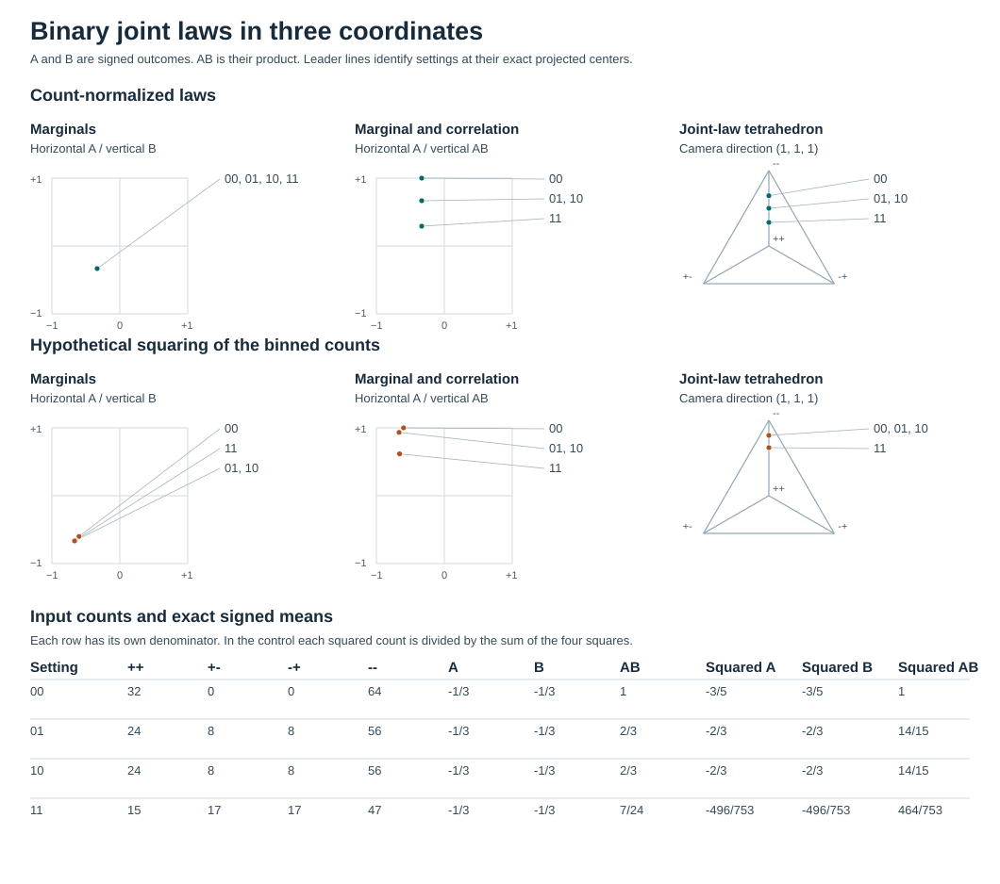

# Orthographic projections of binary joint laws

The four rows of [bell.tsv](bell.tsv) are the conditional predictions of the [terminal-position Bell read](../terminal_bell_read.md). Each row gives integer weights for outcomes $++,+-,-+,--$, in that order. The ordinary rows all have $P(A=+)=P(B=+)=1/3$. Their correlations are $1,2/3,2/3,7/24$. Thus projecting onto the two marginals puts four setting labels at one point. Adding the correlation distinguishes three joint laws. Settings 01 and 10 have exactly the same distribution.



## What the coordinates mean

For binary outcomes $s,t\in\{-1,1\}$, let $a=E[s]$, $b=E[t]$ and $c=E[st]$. Each normalized distribution is one point inside the tetrahedron with vertices $(s,t,st)$. The inverse is $p_{st}=(1+sa+tb+stc)/4$. The tetrahedron describes the allowed probabilities of a **single** setting pair. Bell inequalities compare the laws at multiple settings.

The three views use $(a,b)$, $(a,c)$ and $((b-a)/\sqrt2,(2c-a-b)/\sqrt6)$. The last pair consists of orthonormal axes perpendicular to $(1,1,1)$, so viewing depth has no magnification effect. The first two views both show the full $[-1,1]^2$ square. The oblique view uses the same fixed scale for each distribution. Exact rational coordinates determine coincident labels. Floating point is used only for the SVG drawing coordinates. Nearby unequal points can occupy the same screen pixel. Their labels and exact table entries remain available.

## A control that changes the local marginals

In the second row of panels each **already binned joint cell** is squared, then the four resulting numbers at that setting are normalized to sum to one. With Alice's setting held at 0, changing Bob's setting from 0 to 1 changes her positive probability from $1/5$ to $1/6$. The difference is $1/30$. Holding Bob's setting at 0 and changing Alice's setting gives the same difference in his marginal. These are predictions of a hypothetical response applied at a specified stage. They would violate marginal independence for separated choices under the stated event-ready protocol. Applying a power to individual position wells before binning would be a different transformation.

## Render another joint table

The [Rust source](project.rs) uses the standard library. From this directory:

```sh
rustc --edition=2021 --test project.rs -o projection_tests
./projection_tests
rustc --edition=2021 -O project.rs -o project
./project bell.tsv projection.svg
```

Supply your own tab-separated table with the same five-column header. Each of 1–16 rows needs a distinct setting name and four integer weights from 0 through $10^9$, with a positive row total. Setting names may contain ASCII letters, digits, dots, hyphens and underscores, up to 12 characters. The renderer retains zero cells and displays both the ordinary normalization and its explicitly labeled control. The tests check inverse reconstruction on all 624 nonempty count tables with entries 0 through 4, the lossy Bell projection, the powered marginals, maximal coincident label sets and invalid input.

## Export a camera view or an orbit

The [camera](camera.rs) draws the count-normalized laws, their tetrahedron, and the $[-1,1]^3$ coordinate frame. Each standalone 1060 × 820 SVG includes the original counts and exact signed means. A point on the viewing axis loses its depth in the projection. For example, the four ordinary Bell rows share one plotted center in the $AB$-axis view, while the table still distinguishes their three correlations.

```sh
./project bell.tsv --view marginals.svg -90 90
./project bell.tsv --view alice-correlation.svg -90 0
./project bell.tsv --frames orbit 24
```

Angles are given in degrees. Azimuth increases from $+A$ toward $+B$ and elevation rises toward $+AB$. At azimuth −90°, elevation 90° the horizontal and vertical axes are $A,B$. At the same azimuth and elevation 0° they are $A,AB$. Azimuth also controls the orientation of the frame when viewed from a pole. See the [Matplotlib viewing-angle convention](https://matplotlib.org/stable/api/toolkits/mplot3d/view_angles.html).

The orbit keeps every input row fixed as its azimuth advances by $360°/N$ at elevation 25°. Supply 4–360 frames and a new output directory. The 24-frame example writes `frame_000.svg` through `frame_023.svg`. All frames use 124 pixels per coordinate unit, the same center and the same axis limits. Screen markers at a shared two-decimal SVG position retain every setting label and exact table row. The [data-series example](data_frames.md) changes the joint laws with the camera held fixed.

## Play an exported sequence

Open the [rotating camera](rotation.svg) to see the fixed joint laws from 24 directions. The [marker-overlap sequence](coherence.svg) holds the camera still while the preparation changes. Its fifth frame reaches a Bell score of $49/24$. The display interval is in milliseconds. The [input and derivation](data_frames.md) describe what changes between preparations.

The [Rust animation exporter](animate.rs) embeds the ordered frame files in one offline SVG and uses declarative SVG timing to loop. To inspect a single frame, open its numbered SVG from the export directory. For example, `frame_004.svg` is the last preparation in the five-frame series.

```sh
rustc --edition=2021 --test animate.rs -o animation_tests
./animation_tests
rustc --edition=2021 -O animate.rs -o animate
./project bell.tsv --frames camera-frames 24
./animate camera-frames rotation.svg 120
./project coherence.tsv --series coherence-frames 45 25
./animate coherence-frames coherence.svg 900
```
