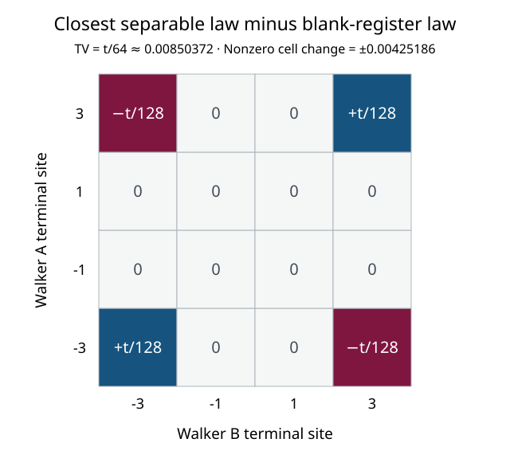

# Exact distance of a two-walker position law from all separable laws

**Kirtus Justus**, Theoretical Physicist, Port Coquitlam, British Columbia, Canada. Mathematical and computational assistance from OpenAI Codex.

This candidate research supplement uses the four calibrated local effects and incident joint distribution of the [unread contact loop](../unread_contact_loop.md). It assumes the two-qubit input code, ordinary probabilities, the stipulated coherent contacts, and complete, fixed position detectors. The entries are predictions of the specified model.

Take total variation to be half the sum of the 16 absolute probability differences. The distance from the predicted blank-register law to the set of all laws produced by **complex separable two-qubit states** is exactly \(t/64\), where \(t\) is the root of

\[
 -448+784t+140t^2-125t^3=0,\qquad 0.544238217<t<0.544238219.
\]

This gives \(0.00850372214<d<0.00850372218\). At equality there is an explicit separable explanation. The earlier fixed witness gave the sufficient radius \(1/280\). Both radii concern joint position probabilities, with total incident probability one.

## The accessible state and the missing quadratures

The four effects \(E_i\) in site order \((-3,-1,1,3)\) are the real symmetric matrices with upper triangles \((0,0,1),(1,-1,2),(2,1,1),(1,0,0)\), divided by four. For \(\Phi(M)=(M+M^T)/2\) in the route basis, the data of any state \(\rho\) determine \(S=(\Phi\otimes\Phi)(\rho)\). Write \(x=(2,-2,2,-2)\), \(z=(-4,0,0,4)\), and \(D_i=(I+x_iX+z_iZ)/2\). Specifically, \(\sum_i E_i=I,\ \sum_i x_i E_i=X,\ \sum_i z_i E_i=Z\). The Pauli expansion gives \(S=\sum_{ij}p_{ij}D_i\otimes D_j\).

If \(\rho\) is separable then \(S\) is positive, because on each product term the one-party map \(\Phi\) takes density matrices to positive density matrices. Conversely, a positive reconstructed \(S\) has trace one, is invariant under partial transpose, and itself reproduces the same counts. It is separable by the two-qubit PPT criterion. This accounts for unmeasured local and joint \(Y\) components. [Horodecki, Horodecki and Horodecki](https://arxiv.org/abs/quant-ph/9605038)

The predicted \(64p_0\) has rows \((1,3,3,1),(3,7,5,1),(3,5,19,5),(1,1,5,1)\). Its accessible matrix \(S_0=B/8\) is given by

\[
B=\begin{pmatrix}2&2&2&1\\2&2&1&0\\2&1&2&0\\1&0&0&2\end{pmatrix}.
\]

## A separable distribution at the claimed distance

Set \(L=2Z-X,\ M(t)=4B+t L\otimes L,\ S_*=M(t)/32\). Its trace is one and it is invariant under each local transpose. The determinant factors as \((4-5t)(-448+784t+140t^2-125t^3)\). The lower three-by-three principal block is positive definite. Its successive leading principal minors are \(8-4t,\ (8-4t)^2-(4+t)^2,\ 384-384t-200t^2+100t^3\). All three are strictly positive on the bracket above. At the root the remaining scalar Schur complement vanishes, so \(S_*\) is positive and separable.

The traces \(\operatorname{tr}(E_iL)=(-1/2,0,0,1/2)_i\) give the full change in the observed law. In zero-based indices add \(t/128\) to cells \(00,33\), subtract \(t/128\) from \(03,30\), and keep the remaining twelve cells. Thus its distance from \(p_0\) is \(t/64\).

## A score proving global optimality

Choose \(v\) as the first adjugate column of \(M(t)\), normalized by its first component. The latter is the positive three-by-three minor above, and \(M(t)v=0\). Define the raw scores \(s_{ij}=v^T(D_i\otimes D_j)v\). Their expectation is \(v^TSv\). Exploit the redundancy \(\sum_i n_i E_i=0\) with \(n=(3,-1,-1,3)\). Put

\[
 h=(0,-1,0,(s_{00}-s_{33})/6),\qquad H_{ij}=s_{ij}+n_i h_j+h_i n_j .
\]

These corrections leave every physical expectation unchanged. On every separable state \(\mathbb E H\ge0\); on the attaining state \(S_*\) the expectation is zero. The construction makes \(H_{00}=H_{33}\) and symmetry gives \(H_{03}=H_{30}\). Rational interval arithmetic over the displayed root bracket puts those respective values in \((5.79670,5.79671)\) and \((-10.20739,-10.20738)\); every other score lies between \(-6.935\) and \(3.653\). Thus the primal perturbation transfers mass only from global minima to global maxima. Writing \(w=\max H-\min H\), its score difference is \(w\,t/64\).

For any separable law \(q\) this gives \(\mathbb E_q H-\mathbb E_{p_0}H\ge w\,t/64\). On a finite outcome set the left side is at most \(w\,\mathrm{TV}(p_0,q)\), by separating positive and negative mass differences. Together with the constructed distribution this proves equality. A numerical search suggested the four corners. The exact certificate proves the global optimum independently of the search or a symmetry ansatz.

## Reproduce the position figure

The [Rust renderer](projection.rs) has no external dependencies. From this directory, compile it with Rust 2021 and write its output directly to SVG.

~~~sh
rustc --edition=2021 --test projection.rs -o projection_tests
./projection_tests
rustc --edition=2021 projection.rs -o projection
./projection position_difference.svg
~~~

Two joint endpoint corners gain $t/128$ each, two lose $t/128$ each, and the remaining twelve are unchanged. Every row and column of this difference sums to zero. Either walker’s terminal-site marginal alone therefore loses the entire distinction between these two laws. The color of each discrete cell is constant. Its written label gives its exact coefficient. Both decimal labels are checked by rational rounding at both ends of the certified root bracket. The renderer obtains the cell signs from the four local effects and the matrix $L$ in the proof. [SVG coordinate systems](https://www.w3.org/TR/SVG2/coords.html) · [SVG rectangular cells](https://www.w3.org/TR/SVG2/shapes.html#RectElement)
